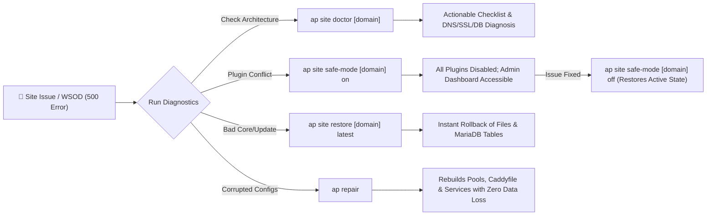

<p align="center">
  
</p>

<h1 align="center">AgilePanel (<code>ap</code>)</h1>

<p align="center">
  <strong>The Ultra-Fast, Security-Hardened CLI Control Panel for WordPress & Modern PHP on Bare-Metal Linux</strong>
</p>

<p align="center">
  <a href="https://github.com/webtechj/agilepanel/releases"></a>
  <a href="https://github.com/webtechj/agilepanel/tree/development"></a>
  
  
  
  
  
  
  <a href="https://github.com/webtechj/agilepanel"></a>
  <a href="https://github.com/webtechj/agilepanel"></a>
  <a href="https://github.com/webtechj/agilepanel"></a>
  
</p>

---

### 📑 Table of Contents
- [⚡ Overview & Philosophy](#-overview--philosophy)
- [⚖️ How AgilePanel Compares](#️-how-agilepanel-compares)
- [🏛️ System Architecture](#️-system-architecture)
- [🛡️ Enterprise-Grade Security Architecture](#️-enterprise-grade-security-architecture)
- [🚀 High-Performance Optimizations & Auto-Tuning](#-high-performance-optimizations--auto-tuning)
- [🩺 Diagnostics, Disaster Recovery & Healing](#-diagnostics-disaster-recovery--healing)
- [📥 Installation & Quickstart](#-installation--quickstart)
- [🛠️ Complete CLI Command Reference](#️-complete-cli-command-reference)
  - [🌐 Site Management (`ap site`)](#-site-management-ap-site)
  - [🖥️ Server Administration (`ap server`)](#️-server-administration-ap-server)
  - [📊 Stack Dashboard & Global Diagnostics](#-stack-dashboard--global-diagnostics)
  - [🔧 Server Tools & Extensions (`ap tool` / `ap install` / `ap gui`)](#-server-tools--extensions-ap-tool--ap-install--ap-gui)
- [📊 Telemetry & Privacy Disclosure](#-telemetry--privacy-disclosure)
- [📄 License & Contributing](#-license--contributing)

---

## ⚡ Overview & Philosophy

**AgilePanel (`ap`)** is a minimalist, modern, and hyper-fast VPS hosting engine crafted specifically for high-traffic WordPress sites, WooCommerce storefronts, Laravel applications, and custom PHP environments on Ubuntu and Debian bare-metal servers.

Traditional web hosting control panels (like cPanel, Plesk, or CyberPanel) run bloated, multi-layered background daemons that consume hundreds of megabytes of RAM just idling on your server. Worse, they expose administrative web ports to the public internet, introducing dangerous attack vectors.

AgilePanel flips this model on its head:
* **Zero Daemon Overhead**: Compiled as a single static Go binary. When you aren't running an `ap` command, AgilePanel consumes **0 MB** of system memory and **0%** CPU.
* **Native Bare-Metal Services**: Directly provisions and couples battle-tested native packages: **Caddy v2** (HTTP/3 + automated SSL), **MariaDB**, **Redis**, and **PHP-FPM (8.1, 8.2, 8.3)**.
* **Security By Construction**: Zero-trust system user isolation per site, rigorous PHP jailbreaks prevention (`open_basedir`), blocked recursive script execution in upload directories, and automated firewall and SSH hardening.
* **Zero Downtime Updates & Swapping**: Switch PHP runtimes, expand memory limits, or renew TLS certificates instantaneously with zero dropped requests.

---

## ⚖️ How AgilePanel Compares

| Feature / Metric | AgilePanel (`ap`) | Legacy Panels (cPanel / Plesk) | Script Wrappers (e.g. WordOps) |
| :--- | :---: | :---: | :---: |
| **Idle Memory Footprint** | **0 MB (Static CLI)** | 800 MB – 1.8 GB (Heavy Daemons) | ~150 MB (Python / Nginx Daemons) |
| **Web Server Technology** | **Caddy v2 (Native HTTP/3 + Auto-TLS)** | Apache / Nginx + Certbot Crons | Nginx + Certbot |
| **Tenant Isolation** | **Dedicated System User per Site** | Shared or Heavy Virt Overhead | Often Shared `www-data` |
| **PHP Hardening (`open_basedir`)** | **Enforced by Default** | Optional / Complex | Inconsistent |
| **Uploads Script Execution Guard** | **Recursive Regex Filter (Double-Ext Block)** | Manual `.htaccess` config | Basic Nginx Location |
| **Redis & DB Coupling** | **High-Speed Local UNIX Sockets** | TCP Loopback (Network Latency) | Mixed TCP / Sockets |
| **Dynamic Memory Limits** | **CLI Flags + `wp-config.php` Sync** | Manual Multi-File Editing | Manual PHP ini edits |
| **Health Check & Self-Healing** | **Built-in `ap site doctor` + Safe Mode** | Third-party Plugins | Basic Service Status |
| **Cloud Backups (S3 / R2 / B2)** | **Native CLI Integration + Pruning** | Paid Addon / Plugins | Custom Scripting Required |
| **Public Attack Surface** | **Minimal (No exposed panel port by default)** | Exposed High-Risk Ports (2083/8443) | Exposed Port 22222 |

---

## 🏛️ System Architecture

The following diagram illustrates how incoming traffic traverses AgilePanel's isolated, high-performance infrastructure:

```mermaid
graph TD
    Client(["🌐 Client / Browser"]) -->|HTTP/3 & HTTPS (Port 443)| Caddy["🚀 Caddy v2 Reverse Proxy"]
    
    subgraph Caddy Security & Performance Layer
        Caddy --> F1["🛡️ Security Headers & HSTS Preload"]
        Caddy --> F2["📦 Dual Compression (Gzip + Zstd)"]
        Caddy --> F3["⛔ Block Dotfiles & Sensitive Files (/xmlrpc.php, wp-config.php)"]
        Caddy --> F4["🚫 Block PHP in /wp-content/uploads/ (*.php, *.phar, *.phtml, double extensions)"]
        Caddy --> F5["⚡ 1-Year Immutable Static Asset Browser Caching"]
    end

    F4 -->|Local UNIX Socket 0660| PHPPool["⚙️ PHP-FPM Pool (/run/php/php8.3-fpm-domain.sock)"]

    subgraph Sandboxed Tenant Execution
        PHPPool --> U1["👤 Isolated System User (wp_domain)"]
        PHPPool --> U2["🔒 Strict open_basedir (/var/www/domain/:/tmp/:/usr/share/php/)"]
        PHPPool --> U3["🚫 Disabled Functions (exec, system, shell_exec, etc.)"]
        PHPPool --> U4["⚡ Optimized OPcache (256MB) & RAM-Scaled On-Demand Workers"]
    end

    U1 -->|UNIX Socket: /var/run/mysqld/mysqld.sock| MariaDB[("🗄️ MariaDB (30% RAM InnoDB Buffer Pool)")]
    U1 -->|UNIX Socket: /var/run/redis/redis-server.sock (0770)| Redis[("⚡ Redis Object Cache")]
```

---

## 🛡️ Enterprise-Grade Security Architecture

AgilePanel enforces a zero-trust security paradigm at every tier of the operating system and application stack:

### 1. Isolated System User per Website
* When you create a website, AgilePanel automatically provisions an unprivileged Linux system user and matching group (`wp_[sanitized_domain]`).
* Website files are owned exclusively by this dedicated tenant. Even in the event of an arbitrary code injection within a vulnerable WordPress plugin, the attacker is trapped inside that single user account and cannot read, alter, or access files belonging to other websites on the server.

### 2. Hardened PHP-FPM Sandbox
* **Strict `open_basedir` Enclosure**: Every site's PHP pool restricts filesystem traversal strictly to `/var/www/[domain]/`, `/tmp/`, and `/usr/share/php/`. Directory traversal outside the site root is physically blocked at the engine level.
* **Disabled Dangerous Functions**: Essential system calls frequently exploited in web shell attacks are permanently disabled:
  ```ini
  php_admin_value[disable_functions] = exec,shell_exec,system,passthru,popen,proc_open,show_source
  ```
* **Resource Leak Mitigation**: Pools run in `pm = ondemand` mode with `pm.process_idle_timeout = 10s` and `pm.max_requests = 500`. This releases idle RAM back to the operating system immediately and recycles worker processes to prevent memory exhaustion attacks.
* **Restricted Socket Permissions**: FastCGI UNIX sockets are owned strictly by `caddy:caddy` with `0660` permissions.

### 3. Multi-Layer Caddy Exploit Shield
* **Recursive Uploads Script Blocker**: Prevents malicious backdoor execution within media directories using an exhaustive case-insensitive regular expression:
  ```caddy
  path_regexp (?i)^/wp-content/uploads/.*(?:\.php[0-9]*|\.phtml|\.phar|\.phps|\.pht|\.inc)(\.|\/|$)
  ```
  This immediately yields a `403 Forbidden` for standard scripts (`.php`), alternate interpreters (`.phtml`, `.phar`), and double-extension evasion payloads (e.g. `malware.php.jpg` or `shell.phar.png`).
* **Shielded Sensitive Endpoints**: Automatically rejects public requests targeting `xmlrpc.php` (brute-force amplification vector), `install.php`, and `wp-config.php`.
* **Dotfile Concealment**: Recursively blocks access to all hidden files (`*/.*`) like `.git`, `.env`, and `.user.ini`, while explicitly retaining access for ACME challenge directories (`*/.well-known/*`).
* **Default Port 80 Shield**: Directly addressing server IP addresses on port 80 triggers a catch-all block returning `403 Forbidden` with an explicit `X-Robots-Tag: noindex, nofollow, nosnippet, noarchive` header to defeat automated vulnerability crawlers.
* **Modern HTTP Security Headers**: Injects `Strict-Transport-Security: max-age=63072000; includeSubDomains; preload` (HSTS), `X-Content-Type-Options: nosniff`, `X-Frame-Options: SAMEORIGIN`, and `Referrer-Policy: no-referrer-when-downgrade`.

### 4. Host OS Hardening (`ap server secure`)
* **Intelligent UFW Firewall**: Configures Ubuntu/Debian Uncomplicated Firewall (UFW) to enforce strict ingress traffic rules, whitelisting ports `22` (SSH), `80` (HTTP), `443` (HTTPS), `8888` (phpMyAdmin), and `8889` (GUI Companion).
  > [!TIP]
  > **No SSH Lockouts**: `ap server secure` actively reads `/etc/ssh/sshd_config`. If you run SSH on a custom port (e.g. `2222`), it dynamically parses and allows your custom port through UFW automatically before enabling the firewall.
* **SSH Key Enforcement**: Disables password-based root access by setting `PermitRootLogin prohibit-password` in `/etc/ssh/sshd_config`, stopping SSH dictionary brute-force attacks in their tracks.
* **Root Password Aging**: Configures Linux PAM and `chage` to enforce a mandatory 30-day root password expiration cycle (`chage -M 30 root` and `PASS_MAX_DAYS 30`).
* **Automated Disk Sanitization (`ap server clean`)**: Vacuums `systemd-journald` logs down to a 7-day retention window, purges rotated `.gz` and `.old` logs across `/var/log`, wipes expired backups older than 3 days, and purges package manager cache files.

---

## 🚀 High-Performance Optimizations & Auto-Tuning

AgilePanel contains an intelligent hardware-aware tuning engine (`ap server tune`) that benchmarks host resources and dials in operating system and database parameters:

### ⚡ Zero-Latency UNIX Socket Coupling
By eliminating network loopback overhead (`127.0.0.1:3306`, `127.0.0.1:6379`, `127.0.0.1:9000`), all inter-process communication between Caddy, PHP-FPM, MariaDB, and Redis executes through dedicated Linux UNIX sockets. Redis socket permissions are tightened to `0770` (`redis:caddy`) for peak security and microsecond response times.

### 🗄️ MariaDB InnoDB Memory Dynamic Scaling
* **RAM Allocation**: Audits server RAM and automatically scales `innodb_buffer_pool_size` to 30% of total memory.
* **Multi-Core Scaling**: Distributes the buffer pool across multiple buffer pool instances matching CPU core count to eliminate thread lock contention on multi-core servers.
* **Transaction Flushes**: Sets `innodb_flush_log_at_trx_commit = 2` for high write throughput on NVMe/SSD storage and turns off unnecessary binlog replication overhead.

### 🧠 Smart Swap & Kernel Swappiness Tuning
* **Virtualization Awareness**: Differentiates bare-metal, KVM, Xen, and Cloud VPS instances from container environments (Docker, LXC, OpenVZ). Container instances skip swapfile generation to comply with host kernel boundaries.
* **Resilient Swap Allocation**: Provisions a dedicated `/swapfile` scaled to system RAM using high-speed `fallocate`, with a fallback to `dd` if sparse files are unsupported. Automatically detects **Btrfs** root filesystems and disables Copy-on-Write (`chattr +C`) and file compression before allocation.
* **Kernel Sysctl Optimizations**: Sets `vm.swappiness = 10` and `vm.vfs_cache_pressure = 50` so that RAM is utilized aggressively before paging out to swap disk.

### 📦 Dual Dynamic Compression (Gzip + Zstd)
Caddy automatically serves HTTP responses with both **Zstandard (zstd)** and **Gstandard (gzip)** compression (`encode gzip zstd`). Modern browsers receive ultra-fast compressed payloads with lower CPU overhead than legacy web servers.

### 🏎️ WordPress PHP Memory & Heavy Plugins Automation
Allocating sufficient PHP memory for heavy page builders (such as Elementor, Divi, or WooCommerce) is completely automated:
* Running `ap site create [domain] --heavy-plugins` or `ap site update [domain] --heavy-plugins` scales PHP memory to **256MB**, `max_input_vars` to **5000**, and `max_execution_time` to **300s**.
* Seamlessly syncs both the PHP-FPM pool configuration and the WordPress constants `WP_MEMORY_LIMIT` and `WP_MAX_MEMORY_LIMIT` in `wp-config.php` simultaneously.

---

## 🩺 Diagnostics, Disaster Recovery & Healing

AgilePanel is designed for production resiliency, providing instant recovery tools when sites fail:



* **`ap site doctor [domain]`**: Comprehensive pre-flight health diagnostic. Checks DNS resolution (and flags Cloudflare proxy / IP mismatches), evaluates SSL validity and flags certificates nearing expiration (<14 days), tests MariaDB credentials and runs `wp db check`, verifies `wp-config.php` integrity, and scans `wp-content/debug.log` for fatal errors.
* **`ap site safe-mode [domain] [on|off]`**: Rescues sites from White Screen of Death (WSOD). Passing `on` snapshots currently active plugins into a state marker and deactivates them via WP-CLI to restore admin access. Passing `off` reads the snapshot and seamlessly re-activates precisely the plugins that were active before.
* **`ap site restore [domain] [target]`**: Instant rollback of website files (`htdocs`) and MariaDB database schemas from timestamped local backups or cloud archives.
* **`ap site lock / unlock [domain]`**: Locks a website directory to read-only/immutable attributes (`chattr +i`) to prevent file uploads or malicious script tampering during active attacks, and unlocks it when you need to run core/plugin updates.
* **`ap site reset-pass [domain] [user] [pass]`**: Emergency reset of WordPress administrator credentials directly via WP-CLI.
* **`ap repair [--ssh-password-recovery]`**: Non-destructive repair utility. Rebuilds all Caddy configurations, PHP-FPM pools, and Redis connections without touching your databases, website files, or user data. Includes a recovery flag to temporarily enable SSH root password login if keys are misplaced.

---

## 📥 Installation & Quickstart

Ensure your VPS has a fresh installation of **Ubuntu 22.04+ LTS** or **Debian 11+** with root (`sudo`) privileges.

### Standard Installation (Latest Stable Release)

Run the one-liner command on your server:

```bash
curl -sSL https://raw.githubusercontent.com/webtechj/agilepanel/main/install.sh | sudo bash
```

The installer will prompt interactively for the administrator's **Name** and **Email** (used for automatic SSL certificate registration via Let's Encrypt / ZeroSSL).

#### Non-Interactive Headless Installation
For scripted VPS provisioning, supply admin details via environment variables:

```bash
ADMIN_NAME="DevOps Admin" ADMIN_EMAIL="admin@yourdomain.com" \
  curl -sSL https://raw.githubusercontent.com/webtechj/agilepanel/main/install.sh | sudo -E bash
```

### Development Branch Installation

> [!WARNING]
> The `development` branch contains bleeding-edge features and is recommended for testing environments.

```bash
AP_CHANNEL=branch AP_BRANCH=development \
  curl -sSL https://raw.githubusercontent.com/webtechj/agilepanel/development/install.sh | sudo -E bash
```

To configure your VPS to permanently follow the development branch:
```bash
echo 'AGILEPANEL_UPDATE_BRANCH=development' | sudo tee -a /etc/environment
```

---

## 🛠️ Complete CLI Command Reference

All operations are managed through the `ap` command. Command arguments are documented below with their syntax and available flags:

### 🌐 Site Management (`ap site`)

#### `ap site create [domain] [flags]`
Provisions an isolated website environment with system user, database, SSL certificate, and FastCGI pool.
```bash
# Interactive creation wizard
sudo ap site create

# Deploy WordPress site with PHP 8.3
sudo ap site create example.com --wp --php 8.3

# Deploy WooCommerce site optimized for heavy page builders (256M RAM, 5000 input vars)
sudo ap site create shop.example.com --type woocommerce --heavy-plugins

# Deploy custom PHP site with 512M memory allocation
sudo ap site create app.example.com --type php --php 8.3 --memory 512M

# Deploy static HTML site without database
sudo ap site create landing.example.com --type html --db false

# Automated WordPress install with custom credentials
sudo ap site create blog.example.com --wp \
  --wp-user admin --wp-pass "SuperSecret123!" \
  --wp-email "admin@example.com" --wp-name "Blog Admin"

# Create site and import existing files and database
sudo ap site create migrated.com --type wp \
  --import-files /tmp/site_files.zip --import-db /tmp/site_db.sql
```
*   `--php [version]`: Target PHP version (`8.1`, `8.2`, `8.3`). Default: `8.3`.
*   `--type [type]`: Site preset: `wp` (WordPress), `woocommerce`, `laravel`, `php`, or `html`.
*   `--wp`: Shortcut flag for `--type wp`.
*   `--heavy-plugins`: Allocates 256MB PHP memory, 5000 `max_input_vars`, and 300s timeout for Elementor, Divi, or WooCommerce.
*   `--memory [size]`: Explicit custom memory limit (e.g. `128M`, `256M`, `512M`, `1024M`).
*   `--db [default|true|false]`: Explicitly enable or disable MariaDB database provisioning.
*   `--import-files [path]`: Path to local ZIP archive to extract into web root during creation.
*   `--import-db [path]`: Path to local SQL or ZIP dump to import into database during creation.
*   `--wp-user [username]`: WordPress administrative username.
*   `--wp-pass [password]`: WordPress administrative password.
*   `--wp-email [email]`: WordPress administrator email.
*   `--wp-name [name]`: WordPress administrator display name.

#### `ap site update [domain] [flags]`
Modifies PHP versions, memory limits, and performance parameters for an existing site with zero downtime.
```bash
# Switch to PHP 8.3 using convenient quick-flag
sudo ap site update example.com --php83

# Switch to PHP 8.2 with custom 512M memory limit
sudo ap site update example.com --php 8.2 --memory 512M

# Apply heavy plugins profile (256MB RAM, 5000 input vars, 300s timeout, WP constants sync)
sudo ap site update example.com --heavy-plugins
```
*   `--php [version]`: Target PHP version (`8.1`, `8.2`, `8.3`).
*   `--php81`: Shortcut to switch site to PHP 8.1.
*   `--php82`: Shortcut to switch site to PHP 8.2.
*   `--php83`: Shortcut to switch site to PHP 8.3.
*   `--memory [size]`: Set custom PHP memory limit (e.g. `256M`, `512M`).
*   `--heavy-plugins`: Apply high-performance page builder profile.

#### `ap site delete [domain] [-y|--yes]`
Completely tears down a website, unlinks system users, removes database schemas, and cleans web folders. Requires dual confirmation by default.
```bash
sudo ap site delete example.com
sudo ap site delete example.com -y  # Bypass confirmation prompts
```

#### `ap site list`
Displays a structured table of all hosted websites, their operational status, PHP versions, and site types.
```bash
sudo ap site list
```

#### `ap site info [domain]`
Queries web root directories, database credentials, active FPM pool sockets, configuration state, and SSL status.
```bash
sudo ap site info example.com
```

#### `ap site edit [domain]`
Opens the site's PHP-FPM configuration pool file in the system default text editor (`$EDITOR`).
```bash
sudo ap site edit example.com
```

#### `ap site lock [domain] [-y|--yes]` / `ap site unlock [domain]`
Toggles write protection by applying or removing immutable Linux file attributes (`chattr +i`).
```bash
sudo ap site lock example.com      # Freeze site files to prevent web shells / injection
sudo ap site unlock example.com    # Restore write permissions for plugin/core updates
```

#### `ap site cache-clean [domain] [flags]`
Purges site caching layers. If no flags are provided, flushes all caching tiers simultaneously.
```bash
sudo ap site cache-clean example.com            # Clean all cache layers
sudo ap site cache-clean example.com --wp       # Clean WP transients & object cache
sudo ap site cache-clean example.com --redis    # Flush site Redis cache
sudo ap site cache-clean example.com --opcache  # Reload PHP-FPM pool to flush OPcache
sudo ap site cache-clean example.com --caddy    # Flush Caddy edge/HTTP cache
```

#### `ap site reinstall [domain]`
Non-destructively replaces WordPress core files and regenerates database tables under existing credentials.
```bash
sudo ap site reinstall example.com
```

#### `ap site ssl-renew [domain]`
Forces Caddy to evict local certificate cache and request a fresh Let's Encrypt / ZeroSSL TLS certificate.
```bash
sudo ap site ssl-renew example.com
```

#### `ap site fix-permissions [domain]`
Recursively sets directories to `0755` and files to `0644`, resetting ownership to the site's unprivileged user.
```bash
sudo ap site fix-permissions example.com
```

#### `ap site backup [domain]` & `ap site backup-db [domain]`
Creates separate manual ZIP archives of website files and raw SQL database dumps under `/var/www/[domain]/backup/`. Automatically prunes older local archives to retain the 2 most recent versions.
```bash
sudo ap site backup example.com     # Generates separate ZIPs for web files & MariaDB
sudo ap site backup-db example.com  # Generates timestamped SQL dump only
```

#### `ap site restore [domain] [backup-target] [-y|--yes]`
Rolls back website files (`htdocs`) and/or database schemas from backup archives.
```bash
sudo ap site restore example.com latest                # Restore latest backup
sudo ap site restore example.com 20261016-120000 -y   # Restore specific backup timestamp
```

#### `ap site doctor [domain]`
Audits DNS reachability, SSL validity, PHP-FPM pool existence, MariaDB connectivity, `wp-config.php` placement, and scans `wp-content/debug.log` for fatal errors.
```bash
sudo ap site doctor example.com
```

#### `ap site reset-pass [domain] [username] [password]`
Directly resets a WordPress administrator password via WP-CLI without needing email access.
```bash
sudo ap site reset-pass example.com admin "NewSecurePass123!"
```

#### `ap site safe-mode [domain] [on|off]`
Rescues sites from 500 errors / White Screen of Death by snapshotting and toggling plugin activation.
```bash
sudo ap site safe-mode example.com on   # Deactivates all plugins, snapshots state
sudo ap site safe-mode example.com off  # Restores previously active plugins
```

#### `ap site php-switch [domain] [version]`
Swaps the site's active PHP version (e.g. `8.1`, `8.2`, `8.3`) with zero downtime.
```bash
sudo ap site php-switch example.com 8.3
```

#### `ap site optimize [domain]`
Defragments MariaDB database tables, purges expired transients, and deletes spam/trash comments.
```bash
sudo ap site optimize example.com
```

#### `ap site s3-list` / `s3-download` / `s3-delete`
Manages offsite cloud backups stored on S3-compatible cloud storage (AWS S3, Wasabi, Backblaze B2, Cloudflare R2, MinIO).
```bash
sudo ap site s3-list example.com              # List S3 cloud backups
sudo ap site s3-list example.com --json       # Output S3 backup records in JSON
sudo ap site s3-download example.com 20261016 # Download specific S3 backup
sudo ap site s3-delete example.com 20261016   # Delete specific S3 backup
```

---

### 🖥️ Server Administration (`ap server`)

#### `ap server status`
Displays real-time system performance, CPU load averages, visual RAM/Swap/Disk progress bars, active TCP connections, top 5 real-time processes, and last 24 hours historical peak metrics.
```bash
sudo ap server status
```

#### `ap server auth [username] [password]`
Configures bcrypt-encrypted HTTP Basic Authentication credentials protecting phpMyAdmin and administrative tools.
```bash
sudo ap server auth admin "StrongAdminPass456!"
```

#### `ap server tune [flags]`
Audits hardware specifications and configures optimized swap allocation, kernel swappiness sysctl parameters, MariaDB InnoDB buffer pool size, and Redis UNIX socket scaling.
```bash
sudo ap server tune
sudo ap server tune --admin-name "New Admin" --admin-email "admin@example.com"
```
*   `--admin-name [name]`: Updates the global server administrator name.
*   `--admin-email [email]`: Updates the global administrator email for SSL certificate notifications.

#### `ap server secure`
Hardens Ubuntu/Debian server policies:
1. Enforces 30-day password aging on `root` (`chage -M 30 root` and `/etc/login.defs`).
2. Configures UFW firewall for ports 22, 80, 443, 8888, 8889 while automatically detecting and preserving custom SSH ports.
3. Sets `PermitRootLogin prohibit-password` in `sshd_config` to enforce SSH key authentication.
```bash
sudo ap server secure
```

#### `ap server clean`
Safely reclaims disk space by purging rotated logs, vacuuming `systemd-journald` to a 7-day window, deleting backup archives older than 3 days, and running `apt-get clean` and `apt-get autoremove`.
```bash
sudo ap server clean
```

#### `ap server restart [service|all]`
Gracefully restarts individual services or the entire web stack.
```bash
sudo ap server restart caddy
sudo ap server restart mariadb
sudo ap server restart redis
sudo ap server restart php-fpm
sudo ap server restart all
```

#### `ap server unlock-gui`
Disables secondary GUI dashboard session security PIN locks in the event of administrative lockout.
```bash
sudo ap server unlock-gui
```

---

### 📊 Stack Dashboard & Global Diagnostics

#### `ap info`
Renders an ASCII banner and a structured dashboard detailing AgilePanel version, binary path, configuration state, host OS/architecture, public IP, hosted site counts, Web GUI Addon status, and service socket paths.
```bash
sudo ap info
```

#### `ap repair [--ssh-password-recovery]`
Rebuilds and re-aligns all Caddyfile configuration blocks, PHP-FPM pools, and Redis connections without touching your databases, website files, or user accounts.
```bash
sudo ap repair
sudo ap repair --ssh-password-recovery  # Enables SSH root password login during recovery
```

#### `ap sync`
Scans `/var/www/` for pre-existing website directories, reads database credentials directly from `wp-config.php`, and registers orphan sites back into AgilePanel's state registry (`state.json`).
```bash
sudo ap sync
```

#### `ap update` & `ap upgrade`
*   `ap update`: Refreshes package lists (`apt-get update`), checks GitHub for the latest release, and self-updates the `/usr/local/bin/ap` executable.
*   `ap upgrade`: Non-interactively applies OS security updates (`apt-get upgrade -y`) and executes `ap repair` to keep web services synchronized.
```bash
sudo ap update
sudo ap upgrade
```

---

### 🔧 Server Tools & Extensions (`ap tool` / `ap install` / `ap gui`)

#### phpMyAdmin Management (`ap tool`)
Deploy phpMyAdmin on a dedicated global port (`:8888`) shielded behind HTTP Basic Authentication:
```bash
sudo ap tool install phpmyadmin  # Installs phpMyAdmin on http://[SERVER-IP]:8888
sudo ap tool fix-phpmyadmin      # Regenerates config.inc.php with a fresh Blowfish secret
```

#### Web GUI Dashboard Companion (`ap install` / `ap gui`)
For administrators who prefer an optional browser dashboard alongside the CLI:
```bash
sudo ap install gui    # Downloads and configures the GUI daemon on port 8889
sudo ap gui enable     # Starts and enables agilepanel-gui.service
sudo ap gui disable    # Stops and disables the service, blocks port 8889 in UFW
sudo ap gui update     # Downloads latest compiled GUI binary and restarts daemon
```

---

## 📊 Telemetry & Privacy Disclosure

AgilePanel collects minimal, fully anonymized usage telemetry solely to track active installations and render live statistics badges on this repository.

### What is Collected?
* A randomly generated unique server UUID (stored locally in `/etc/agilepanel/state.json`)
* Host Operating System & CPU Architecture (e.g. `linux / amd64`)
* Current AgilePanel binary version (e.g. `1.1.7`)
* Total count of hosted WordPress sites

> [!NOTE]
> We **never** collect, transmit, or store server IP addresses, domain names, database credentials, site content, or administrative passwords. Telemetry pings execute asynchronously and will never block or slow down CLI commands.

### Opting Out
You can permanently disable telemetry at any time by setting `AGILEPANEL_TELEMETRY_URL` to `"none"` in your environment:
```bash
echo 'export AGILEPANEL_TELEMETRY_URL="none"' | sudo tee -a /etc/environment
source /etc/environment
```

---

## 📄 License & Contributing

AgilePanel is free, open-source software licensed under the [MIT License](LICENSE).

Contributions, bug reports, and pull requests are welcomed!
* **Issue Tracker**: [GitHub Issues](https://github.com/webtechj/agilepanel/issues)
* **Releases**: [GitHub Releases](https://github.com/webtechj/agilepanel/releases)
* **Development Branch**: [Development Tree](https://github.com/webtechj/agilepanel/tree/development)

<p align="center">
  <sub>Built with ❤️ for high-performance WordPress & PHP hosting engineers.</sub>
</p>
